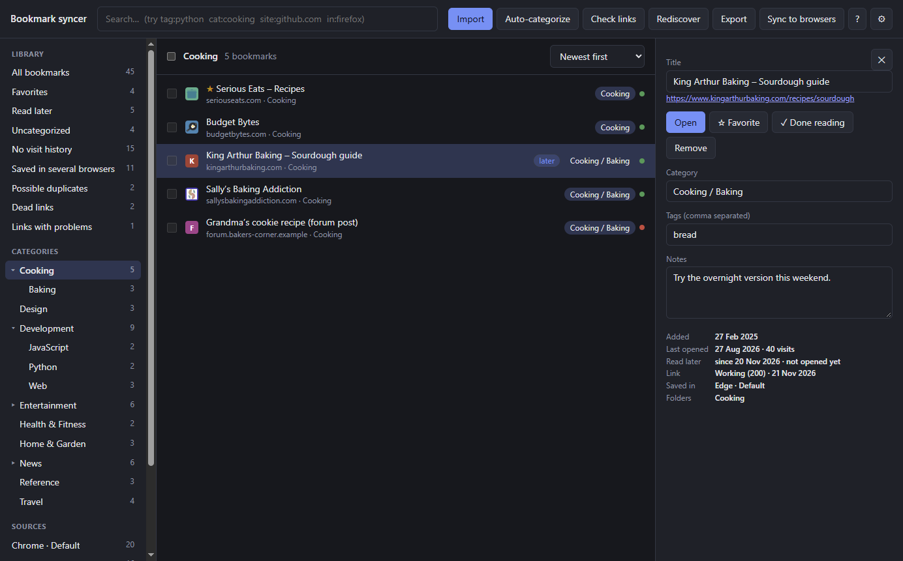

# Bookmark syncer

*A small vibecoded app for syncing bookmarks between multiple browsers.*

A Windows desktop app that reads the bookmarks from every browser on your PC (Chrome, Edge, Brave, Vivaldi, Opera, Comet, Firefox, Zen, Floorp, Waterfox), merges the duplicates, and gives you one searchable, categorized library. You can sort it with built-in rules, a local AI (Ollama), or Claude, check which links are dead, clean out what you no longer need, and export the result back to any browser.

Your browsers' own bookmarks are only **read**, except when you click **Sync to browsers** (or use the browser extension), which removes the ones you deleted after showing a preview.



## Features

| | |
|---|---|
| **Import** | Finds every browser profile on the PC automatically; browsers you don't have never show up. You can also import any exported `bookmarks.html`. Re-importing only adds what's new. |
| **Merge duplicates** | URLs are cleaned up (tracking parameters, `www.`, trailing slashes), so the same page saved in three browsers becomes one entry that remembers every place it came from. |
| **Near-duplicates** | *Possible duplicates* lists the same page under different URLs (`m.` and AMP pages, `youtu.be` links, `index.html`, same title on the same page). **Keep this one** merges the others into it (the browsers aren't touched), or mark them *Not duplicates*. With Undo. |
| **Import automatically** | New bookmarks are imported when the app starts and while it's open (about once a minute; Firefox at most every 10 minutes). Only profiles you imported before. Settings to turn it off. |
| **Auto-categorize** | Assigns a category and tags. Choose the engine in ⚙ Settings: **Built-in rules** (offline, instant), **Local AI** with Ollama (free, private), or **Claude** (best results, needs an API key). |
| **Smart views** | Favorites, Read later, uncategorized, no visit history, not opened in a year, saved in several browsers, possible duplicates, dead links, links with problems. |
| **Category tree** | Categories with ` / ` in their name (`Cooking / Baking`) show as a tree you can fold open. Right-click a parent → *Keep only the sub-category names* or *Merge sub-categories into this one*. |
| **Drag and drop** | Drag bookmarks (or a selection) onto a category, *Uncategorized*, *Favorites* or *Read later* in the sidebar. Hovering over a closed category opens it. |
| **Read later** | A queue: the *Read later* button in the details pane, in the selection bar, or drag onto *Read later*. **✓ Done reading** takes it out. At most once a week the app reminds you about unread ones (or recent bookmarks you never opened). |
| **Search from anywhere** | <kbd>Ctrl</kbd>+<kbd>Alt</kbd>+<kbd>B</kbd> opens the app with the search box ready, from any program. The app can keep running in the tray and start with Windows. Change the keys in ⚙ Settings. |
| **Select & change many** | Tick bookmarks (or Ctrl+click / Shift+click, Ctrl+A for all), then **Set category…**, **Tags…** (add or remove), **★ Favorite / ☆ Unfavorite** or **Delete selected** (<kbd>Del</kbd>). Every change has an **Undo** button. |
| **Keyboard** | <kbd>↑</kbd> <kbd>↓</kbd> (or <kbd>J</kbd> <kbd>K</kbd>), <kbd>PgUp</kbd> <kbd>PgDn</kbd>, <kbd>Home</kbd> <kbd>End</kbd> move through the list and show the details; <kbd>Enter</kbd> opens, <kbd>Space</kbd> ticks, <kbd>Shift</kbd>+<kbd>↑</kbd>/<kbd>↓</kbd> ticks a range, <kbd>Del</kbd> deletes. <kbd>↓</kbd> in the search box jumps to the results. |
| **Backups and moving** | A copy of the library is saved every day. ⚙ Settings → *Library backups* → **Restore…** goes back to one (your current library is saved first, so you can switch back). **Export library…** writes everything (categories, tags, notes, deleted list) to one file; **Import library…** merges such a file into the library on another PC. |
| **Help panel** | The **?** button explains the colors, the workflow and the shortcuts, with a link to this README. |
| **Recently deleted** | Lists everything you deleted, newest first. **Restore** one, a selection, or right-click → *Restore all*. Restored links are imported again in the future. |
| **Clean up** | Right-click **Not opened in a year**, **Dead links** or **Links with problems** → *Delete all*. Deleted links stay deleted on future imports. |
| **Tidy categories** | Right-click a category → *Rename or merge…* (type an existing name to merge), *Remove category* or *Delete all*. All with Undo. |
| **Sync to browsers** | Removes what you deleted here from the browsers' own bookmarks too. It shows a preview first, needs the browser closed, and backs up every file. **Restore from backup…** puts any of those files back. |
| **Browser extension** | For Chrome, Edge, Brave, Vivaldi, Opera and Firefox: the *Bookmark syncer helper* deletes through the browser itself while it's open, so the browser's sync passes the deletions to all your devices. Preview, one click, Undo. See [docs/INSTALL.md](docs/INSTALL.md#7-the-browser-extension). |
| **This page, from the browser** | Click the extension's icon on any page to see whether it's in your library, and set its category, tags, notes and Read later right there. **Save to library** adds it if it's new. |
| **Categories as folders** | The extension can also **sort the browser's bookmarks into folders** by their category (*Other bookmarks → Bookmark syncer → Cooking → Baking*). It only moves them, shows a preview, and **Undo** puts each one back exactly where it was. |
| **Light or dark, English or Swedish** | ⚙ Settings → *Appearance*: follow Windows, or pick light or dark, and the language (English or Svenska; by default the same as Windows). The extension follows the browser's language. |
| **Resizable sidebar** | Drag the edge of the library pane to make it wider or narrower (double-click the edge to reset). The width is remembered. |
| **Search** | Free text, or filters: `tag:python`, `cat:cooking`, `site:github.com`, `in:firefox`. <kbd>Ctrl</kbd>+<kbd>K</kbd> focuses search, and <kbd>Enter</kbd> opens the top hit. |
| **Check links** | Finds dead pages (404, domain gone) and offers the Wayback Machine copy. Can also run by itself every week or month (⚙ Settings → *Check links automatically*); the tray icon then shows how many dead links there are. |
| **Cancel** | Auto-categorize and Check links can be stopped from the progress bar; everything finished so far is kept. |
| **Rediscover** | Opens a random bookmark from the current view. |
| **Export** | Saves the current view as `bookmarks.html`, grouped by category, which any browser can import. |

## Quick start

**Installer:** run `Bookmark-syncer-Setup-<version>.exe` (no Node.js needed). It isn't code-signed, so Windows asks you to confirm: *More info → Run anyway*. Build it with `npm run dist`.

**From the source code:** you need [Node.js](https://nodejs.org) 20 or newer.

```powershell
git clone https://github.com/b0red/Bookmark-synker.git bookmark-syncer
cd bookmark-syncer
npm install
npm start
```

Click **Import**, tick the browsers, then **Import selected**. Full instructions, including the Ollama and Claude setup and troubleshooting, are in **[docs/INSTALL.md](docs/INSTALL.md)**.

## Where your data lives

Everything is stored locally in `%APPDATA%\Bookmark syncer\`. Versions before 0.4 were called Bookmark Library and used `%APPDATA%\Bookmark Library\`; that data is copied over automatically on first start.

| File | Contents |
|---|---|
| `library.sqlite` | Your library (bookmarks, categories, tags, notes, deleted-link list) |
| `settings.json` | Which categorizer to use, Ollama model, import, shortcut and tray options, the extension pairing code |
| `backups\` | A copy of `library.sqlite` from each of the last 14 days, plus the last 10 made right before a restore or an import (⚙ Settings → *Library backups*) |
| `crash.log` | Unexpected errors, if any, to help find problems |
| `anthropic-key.bin` | Your Claude API key, encrypted with your Windows account (only if you saved one) |

The app backs up your library once a day. To go back to a backup, use ⚙ Settings → *Library backups* → **Restore…**. To move to another PC, use **Export library…** there and **Import library…** on the new PC. If the library file is ever damaged, the app starts from the newest backup by itself and keeps the damaged file. To start over, delete `library.sqlite`.

## Privacy

No account, no telemetry, no analytics: the developer receives nothing. Full details: [PRIVACY.md](PRIVACY.md).

- **Built-in rules** and **Ollama**: nothing leaves your PC.
- **Claude**: the title, URL and folder name of the bookmarks being categorized are sent to Anthropic's API.
- **Check links**: the app requests each URL, the same as visiting it, when you click it or, if you turn it on, every week or month. Favicons are loaded from the sites themselves.
- **Browser extension**: talks only to the app on `127.0.0.1` (this PC), using a pairing code. Web pages can't reach it, and your bookmarks aren't sent anywhere. When you click its icon, it reads the open tab's address and title to show that page's entry in your library.

## Documentation

- [docs/INSTALL.md](docs/INSTALL.md): installation, setup and troubleshooting
- [docs/ARCHITECTURE.md](docs/ARCHITECTURE.md): how the code is organized
- [TODO.md](TODO.md): planned features and known issues
- [CHANGELOG.md](CHANGELOG.md): what changed
- [PRIVACY.md](PRIVACY.md): privacy policy

## Development

```powershell
npm test       # library tests, "sync to browsers" on COPIES of your browser files (the real ones aren't touched),
               # the extension bridge + logic on in-memory copies of your bookmark trees, duplicates,
               # automatic import and Read later on throwaway libraries, and the Swedish translation check
npm run check-i18n  # lists texts without a Swedish translation (renderer/lang/sv.js, extension/i18n.js)
npm run smoke  # prints bookmark counts per browser profile
npm run dist   # builds the Windows installer in dist\nnpm run dist:store  # builds the Microsoft Store package (distBookmark-syncer-<version>-Store.appx) to upload in Partner Center
node scripts/make-demo.js  # remakes docs/screenshot.png from a made-up library
```

Built with Electron and sql.js (SQLite compiled to WebAssembly, so no native build tools are needed).

## License

[GPL-3.0](LICENSE)

## Support

Bookmark syncer is free and open source. If it helped you clean up and organize your bookmarks, you can leave a tip:

[](https://ko-fi.com/patrickosterlund)
