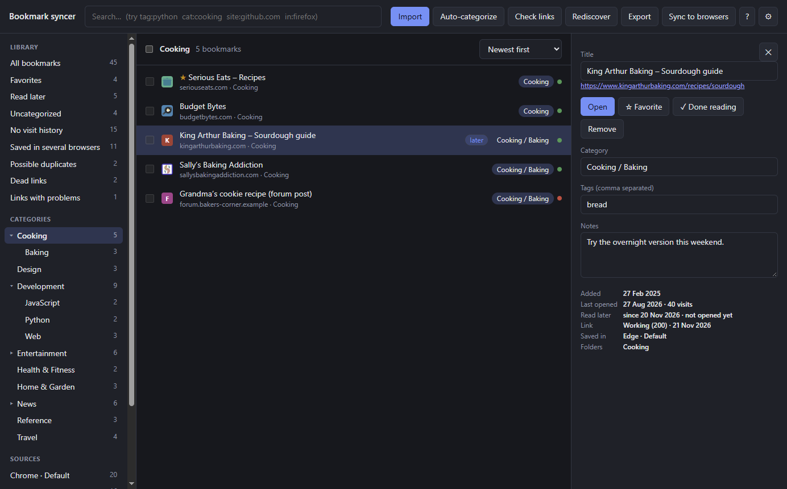

# Bookmark syncer

*En liten vibekodad app för att synka bokmärken mellan flera webbläsare.*

[English](README.md)

En Windows-app som läser bokmärkena från alla webbläsare på datorn (Chrome, Edge, Brave, Vivaldi, Opera, Comet, Firefox, Zen, Floorp, Waterfox), slår ihop dubbletterna och ger dig ett enda sökbart bibliotek med kategorier. Du kan sortera det med inbyggda regler, en lokal AI (Ollama) eller Claude, se vilka länkar som är döda, rensa bort det du inte längre behöver och exportera resultatet tillbaka till vilken webbläsare som helst.

Webbläsarnas egna bokmärken **läses** bara, utom när du klickar på **Synka till webbläsare** (eller använder webbläsartillägget). Då tas de du har tagit bort i appen bort även där, efter en förhandsvisning.

Appen finns på svenska: ⚙ Inställningar → *Utseende* → *Språk* (som standard samma som Windows).



## Funktioner

| | |
|---|---|
| **Importera** | Hittar alla webbläsarprofiler på datorn automatiskt; webbläsare du inte har syns aldrig. Du kan också importera en exporterad `bookmarks.html`. En ny import lägger bara till det som är nytt. |
| **DuckDuckGo** | Bokmärkena är krypterade, så du exporterar dem från DuckDuckGo till mappen Hämtade filer, och importdialogen hittar exporten och importerar den med ett klick. Se [Importera från DuckDuckGo](#importera-från-duckduckgo). |
| **Slå ihop dubbletter** | Adresser städas (spårningsparametrar, `www.`, snedstreck på slutet), så samma sida sparad i tre webbläsare blir ett bokmärke som minns var det kom ifrån. |
| **Nästan-dubbletter** | *Möjliga dubbletter* visar samma sida under olika adresser (`m.`- och AMP-sidor, `youtu.be`-länkar, `index.html`, samma titel på samma sida). **Behåll den här** slår ihop de andra med den (webbläsarna rörs inte), eller markera dem som *Inte dubbletter*. Med Ångra. |
| **Importera automatiskt** | Nya bokmärken importeras när appen startar och medan den är öppen (ungefär en gång i minuten; Firefox högst var 10:e minut). Bara profiler du har importerat förut. Kan stängas av i inställningarna. |
| **Kategorisera automatiskt** | Ger kategori och taggar. Välj motor i ⚙ Inställningar: **Inbyggda regler** (offline, direkt), **Lokal AI** med Ollama (gratis, privat) eller **Claude** (bäst resultat, kräver en API-nyckel). |
| **Smarta vyer** | Favoriter, Läs senare, utan kategori, ingen besökshistorik, inte öppnade på ett år, sparade i flera webbläsare, möjliga dubbletter, döda länkar, länkar med problem. |
| **Kategoriträd** | Kategorier med ` / ` i namnet (`Matlagning / Bakning`) visas som ett träd du kan fälla ut. Högerklicka på en överkategori för att behålla bara underkategoriernas namn eller slå ihop dem. |
| **Dra och släpp** | Dra bokmärken (eller ett urval) till en kategori, *Utan kategori*, *Favoriter* eller *Läs senare* i sidofältet. Håll över en stängd kategori så öppnas den. |
| **Läs senare** | En kö: knappen *Läs senare* i detaljrutan, i urvalsfältet, eller dra till *Läs senare*. **✓ Färdigläst** tar bort den ur kön. Högst en gång i veckan påminner appen om olästa (eller nya bokmärken du aldrig öppnat). |
| **Sök var du än är** | <kbd>Ctrl</kbd>+<kbd>Alt</kbd>+<kbd>B</kbd> öppnar appen med sökrutan redo, från vilket program som helst. Appen kan ligga kvar i meddelandefältet och starta med Windows. Byt tangenter i ⚙ Inställningar. |
| **Markera och ändra många** | Bocka för bokmärken (eller Ctrl+klick / Skift+klick, Ctrl+A för alla), sedan **Ange kategori…**, **Taggar…**, **★ Favorit** eller **Ta bort markerade** (<kbd>Del</kbd>). Varje ändring har en **Ångra**-knapp. |
| **Tangentbord** | <kbd>↑</kbd> <kbd>↓</kbd> (eller <kbd>J</kbd> <kbd>K</kbd>), <kbd>PgUp</kbd> <kbd>PgDn</kbd>, <kbd>Home</kbd> <kbd>End</kbd> flyttar i listan och visar detaljerna; <kbd>Enter</kbd> öppnar, <kbd>Mellanslag</kbd> bockar för, <kbd>Skift</kbd>+<kbd>↑</kbd>/<kbd>↓</kbd> bockar för flera, <kbd>Del</kbd> tar bort. <kbd>↓</kbd> i sökrutan hoppar till träffarna. |
| **Säkerhetskopior och flytt** | En kopia av biblioteket sparas varje dag. ⚙ Inställningar → *Säkerhetskopior av biblioteket* → **Återställ…** går tillbaka till en av dem (ditt nuvarande bibliotek sparas först, så du kan byta tillbaka). **Exportera biblioteket…** skriver allt (kategorier, taggar, anteckningar, borttagna) till en fil; **Importera bibliotek…** slår ihop en sådan fil med biblioteket på en annan dator. |
| **Hjälp** | Knappen **?** förklarar färgerna, arbetsgången och kortkommandona. |
| **Nyligen borttagna** | Allt du har tagit bort, nyast först. **Återställ** ett, ett urval eller alla. Återställda länkar importeras igen i framtiden. |
| **Städa** | Högerklicka på **Inte öppnade på ett år**, **Döda länkar** eller **Länkar med problem** → *Ta bort alla*. Borttagna länkar förblir borttagna vid framtida importer. |
| **Ordna kategorier** | Högerklicka på en kategori → *Byt namn eller slå ihop…* (skriv ett befintligt namn för att slå ihop), ta bort kategorin eller alla dess bokmärken. Allt med Ångra. |
| **Synka till webbläsare** | Tar bort det du har tagit bort här även ur webbläsarnas egna bokmärken. Visar en förhandsvisning först, kräver att webbläsaren är stängd och säkerhetskopierar varje fil. **Återställ från säkerhetskopia…** lägger tillbaka en fil. |
| **Webbläsartillägg** | För Chrome, Edge, Brave, Vivaldi, Opera och Firefox (se [Webbläsare som stöds](#webbläsare-som-stöds)): *Bookmark syncer helper* tar bort bokmärken genom webbläsaren själv medan den är öppen, så att webbläsarens synk för vidare borttagningarna till alla dina enheter. Förhandsvisning, ett klick, Ångra. Se [docs/INSTALL.sv.md](docs/INSTALL.sv.md#7-webbläsartillägget). |
| **Den här sidan, från webbläsaren** | Klicka på tilläggets ikon på en sida för att se om den finns i biblioteket, och ange kategori, taggar, anteckningar och Läs senare direkt där. **Spara i biblioteket** lägger till den om den är ny. |
| **Kategorier som mappar** | Tillägget kan också **sortera webbläsarens bokmärken i mappar** efter kategori (*Andra bokmärken → Bookmark syncer → Matlagning → Bakning*). Det flyttar bara, visar en förhandsvisning, och **Ångra sorteringen** lägger tillbaka varje bokmärke där det låg. *Ta bort mappar som blir tomma* (på som standard) städar bort de gamla mapparna; Ångra återskapar dem också. |
| **Startsida** | ⚙ Inställningar → *Startsida*: en sida med dina favoriter, Läs senare och alla kategorier, med en sökruta, att använda som webbläsarens startsida. Appen håller den uppdaterad. Det är en fil på datorn (`start.html`); döda länkar tas inte med. |
| **Meddelande om ny version** | En gång om dagen frågar appen GitHub om det finns en nyare version och säger till (i fönstret och i meddelandefältet). Den laddar aldrig ner eller installerar något själv. Stäng av det, eller **Kontrollera nu**, i ⚙ Inställningar → *Uppdateringar*. Inte i Microsoft Store-versionen, som Store uppdaterar. |
| **Ljust eller mörkt, svenska eller engelska** | ⚙ Inställningar → *Utseende*: följ Windows eller välj ljust eller mörkt, och språket (som standard samma som Windows). Tillägget följer webbläsarens språk. |
| **Sök** | Fritext eller filter: `tag:python`, `cat:matlagning`, `site:github.com`, `in:firefox`. <kbd>Ctrl</kbd>+<kbd>K</kbd> går till sökrutan, och <kbd>Enter</kbd> öppnar första träffen. |
| **Kontrollera länkar** | Hittar döda sidor (404, domänen borta) och erbjuder kopian i Wayback Machine. Kan också köras av sig själv varje vecka eller månad (⚙ Inställningar → *Kontrollera länkar automatiskt*); ikonen i meddelandefältet visar då hur många döda länkar det finns. |
| **Återupptäck** | Öppnar ett slumpat bokmärke från den aktuella vyn. |
| **Exportera** | Sparar den aktuella vyn som `bookmarks.html`, grupperad efter kategori, som alla webbläsare kan importera. |

## Webbläsare som stöds

Appen visar bara webbläsare som är installerade på datorn; de andra syns aldrig.

| Webbläsare | Import | Synka till webbläsare (fil) | Webbläsartillägg |
|---|---|---|---|
| Chrome, Edge, Brave, Vivaldi, Opera / Opera GX, Chromium | ✓ | ✓ (med webbläsarens synk på: använd tillägget) | ✓ |
| Comet (Perplexity) | ✓ | ✓ (med webbläsarens synk på: använd tillägget) | Bör fungera (Chromium-baserad), inte testat |
| Firefox | ✓ | ✓, även med Firefox Sync | ✓ (privat signerat, eller som tillfälligt tillägg) |
| Zen, Floorp, Waterfox | ✓ | ✓, även med Firefox Sync | Bör fungera (Firefox-baserade), inte testat |
| DuckDuckGo | Genom en export som hittas och importeras med ett klick (se nedan): bokmärkena lagras krypterade, och appen öppnar dem inte | ✗ | ✗ (DuckDuckGo för Windows stöder inte tillägg) |
| Andra webbläsare | Genom en `bookmarks.html`-export | ✗ | ✗ |

Webbläsare som är installerade på ett ovanligt ställe (en portabel kopia, en egen profilmapp) hittas inte automatiskt. Exportera deras bokmärken till `bookmarks.html` och importera den.

### Importera från DuckDuckGo

DuckDuckGo för Windows sparar sina bokmärken i en krypterad databas, låst med samma nyckel som de sparade lösenorden. Bookmark syncer öppnar den inte. Gör så här i stället:

1. I DuckDuckGo: öppna bokmärkeshanteraren (**Manage bookmarks**), välj **Export bookmarks** och spara filen i mappen **Hämtade filer** (Downloads, standard).
2. I Bookmark syncer: klicka på **Importera**. När DuckDuckGo är installerat har dialogen en ruta för DuckDuckGo. Klicka på **Hitta exporten**: appen letar i Hämtade filer efter den nyaste bokmärkesexporten från de senaste 7 dagarna och visar namnet och när den sparades.
3. Klicka på **Importera den**. Bokmärkena läggs till som *DuckDuckGo · export* och slås ihop med det du redan har.

Gör om det när du vill ha DuckDuckGos senaste bokmärken; bara nya läggs till. Appen läser bara filer som verkligen är bokmärkesexporter (den kollar de första raderna), och bara i Hämtade filer. *Synka till webbläsare*, tillägget och den automatiska importen fungerar inte med DuckDuckGo, så bokmärken du tar bort i appen ligger kvar i DuckDuckGo.

## Det här gör den inte

- **Den synkar inte bokmärken mellan datorer eller enheter** på egen hand. Det gör webbläsarnas egen synk (Google-, Microsoft- och Firefox-konton); Bookmark syncer samarbetar med den. Flytta biblioteket till en annan dator med *Exportera biblioteket…* och *Importera bibliotek…*.
- **Den lägger inte till bokmärken i webbläsarna.** *Synka till webbläsare* tar bara bort de du tagit bort i appen, och tillägget tar bara bort eller flyttar (sorterar) dem. Använd **Exportera** och importera `bookmarks.html` i webbläsaren för att få in bokmärken där.
- **Den läser inte din webbhistorik, dina lösenord, kakor eller sidors innehåll**, bara bokmärkena (och, för Firefox-baserade webbläsare, hur ofta en bokmärkt sida har besökts).
- **Den dekrypterar ingenting.** Webbläsare som krypterar sina bokmärken (DuckDuckGo) importeras bara genom en export du gör själv.
- **Den sparar inga kopior av sidor.** En död länk får en länk till Wayback Machine i stället.
- **Den fungerar bara i Windows** (testad i Windows 10). Ingen version för Mac, Linux eller mobil.
- **Den uppdaterar sig inte själv.** Den säger till när en ny version finns; du kör det nya installationsprogrammet. (Microsoft Store-versionen uppdateras av Store.)
- **Den ersätter inte webbläsarens nya flik.** Startsidan är en startsida: bara tillägg får ändra sidan för ny flik.
- **Tillägget finns inte i webbläsarnas tilläggsbutiker.** Du läser in det själv (se [docs/INSTALL.sv.md](docs/INSTALL.sv.md#7-webbläsartillägget)).

## Kom igång

**Installationsprogram:** kör `Bookmark-syncer-Setup-<version>.exe` från [sidan Releases](https://github.com/b0red/Bookmark-synker/releases) (Node.js behövs inte). Det är inte kodsignerat, så Windows ber dig bekräfta: *Mer information → Kör ändå*.

**Microsoft Store:** appen är också på väg till Microsoft Store (som *bookmarker*). Store-versionen är signerad av Microsoft, så ingen SmartScreen-varning visas, och Store håller den uppdaterad. Den använder samma biblioteksmapp som installationsprogrammet.

**Från källkoden:** du behöver [Node.js](https://nodejs.org) 20 eller nyare.

```powershell
git clone https://github.com/b0red/Bookmark-synker.git bookmark-syncer
cd bookmark-syncer
npm install
npm start
```

Klicka på **Importera**, bocka för webbläsarna och klicka på **Importera valda**. Fullständiga instruktioner, med inställning av Ollama och Claude och felsökning, finns i **[docs/INSTALL.sv.md](docs/INSTALL.sv.md)**.

## Var dina data finns

Allt sparas lokalt i `%APPDATA%\Bookmark syncer\`.

| Fil | Innehåll |
|---|---|
| `library.sqlite` | Ditt bibliotek (bokmärken, kategorier, taggar, anteckningar, listan över borttagna länkar) |
| `settings.json` | Dina inställningar och tilläggets parkopplingskod |
| `backups\` | En kopia av `library.sqlite` från var och en av de senaste 14 dagarna, plus de 10 senaste som gjordes precis före en återställning eller import |
| `start.html` | Startsidan, om du har slagit på den (⚙ Inställningar → *Startsida*) |
| `crash.log` | Oväntade fel, om några, för att hitta problem |
| `anthropic-key.bin` | Din Claude-API-nyckel, krypterad med ditt Windows-konto (bara om du har sparat en) |

Appen säkerhetskopierar biblioteket en gång om dagen. Om biblioteksfilen någon gång blir skadad startar appen själv från den senaste säkerhetskopian och behåller den skadade filen. För att börja om, ta bort `library.sqlite`.

## Integritet

Inget konto, ingen telemetri, ingen analys: utvecklaren får ingenting. Alla detaljer (på engelska): [PRIVACY.md](PRIVACY.md).

- **Inbyggda regler** och **Ollama**: ingenting lämnar datorn.
- **Claude**: titel, adress och mappnamn för de bokmärken som kategoriseras skickas till Anthropics API.
- **Kontrollera länkar**: appen anropar varje adress, som när du besöker den, när du klickar på knappen eller, om du slår på det, varje vecka eller månad. Webbplatsikoner hämtas från webbplatserna själva.
- **Meddelande om ny version**: en gång om dagen frågar appen GitHub (`api.github.com`) vilken version som är nyast. GitHub ser din IP-adress, som vid alla besök; ingenting om dig eller dina bokmärken skickas. Stäng av det i ⚙ Inställningar → *Uppdateringar*. Inte i Microsoft Store-versionen.
- **Startsidan**: en fil på datorn som inte hämtar något från webben.
- **Webbläsartillägget**: pratar bara med appen på `127.0.0.1` (den här datorn), med en parkopplingskod. Webbsidor kommer inte åt det, och dina bokmärken skickas ingenstans. När du klickar på ikonen läser det den öppna flikens adress och titel för att visa sidans post i biblioteket.

## Dokumentation

- [docs/INSTALL.sv.md](docs/INSTALL.sv.md): installation, inställningar och felsökning
- På engelska: [README.md](README.md), [docs/INSTALL.md](docs/INSTALL.md), [docs/ARCHITECTURE.md](docs/ARCHITECTURE.md) (hur koden är uppbyggd), [TODO.md](TODO.md), [CHANGELOG.md](CHANGELOG.md), [PRIVACY.md](PRIVACY.md)

## Licens

[GPL-3.0](LICENSE)

## Stöd

Bookmark syncer är gratis och öppen källkod. Om den hjälpte dig att städa och ordna dina bokmärken kan du lämna dricks:

[](https://ko-fi.com/patrickosterlund)
